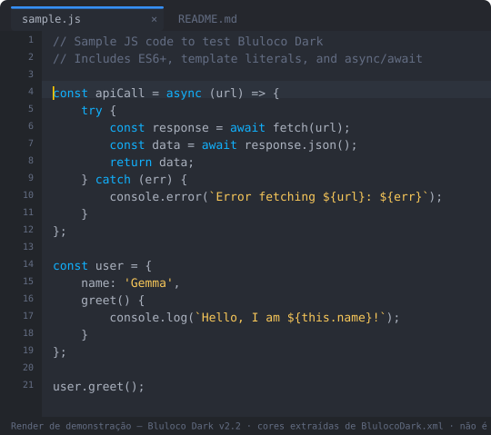
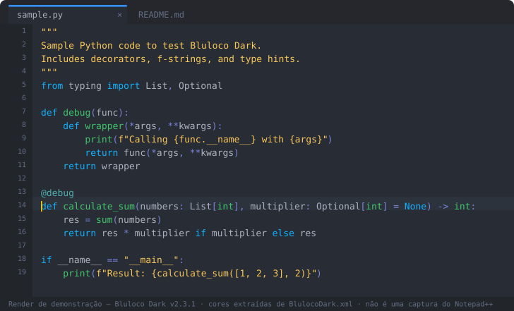
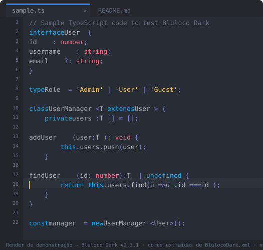
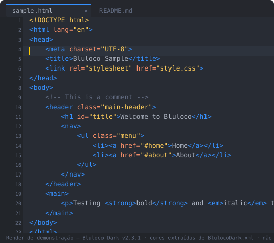
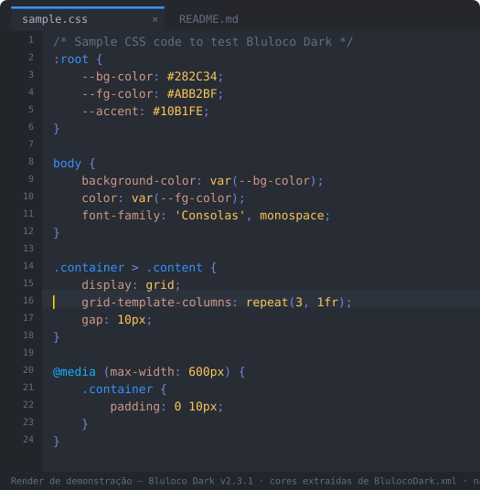
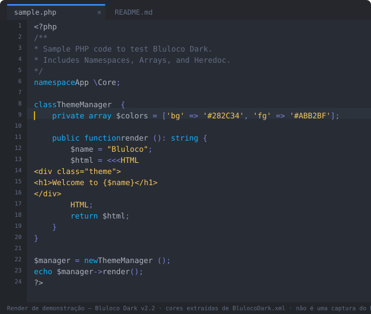
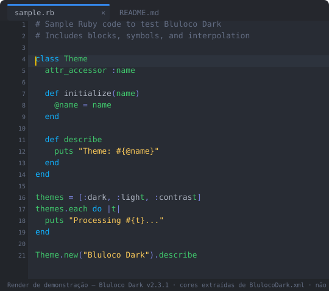

# Bluloco Dark Theme for Notepad++

A complete port of the Bluloco Dark Visual Studio Code theme to Notepad++. This theme brings the beautiful, carefully crafted Bluloco color scheme to Notepad++ with syntax highlighting across **67 lexers** (see **Known Limitations** for the exact coverage caveats).



*Programmatic SVG preview generated from the current theme XML; not a Notepad++ screenshot. Historical PNG captures in `screenshots/` predate the v2.1 palette normalization and are not evidence of the current appearance.*

## 🎨 About Bluloco

Bluloco is a sophisticated color scheme that combines blue-based accents with a carefully balanced palette that's easy on the eyes during long coding sessions. The dark variant provides excellent contrast while maintaining readability.

### 🔗 Source Provenance

| Item | Value |
|------|-------|
| **Upstream project** | [uloco/theme-bluloco-dark](https://github.com/uloco/theme-bluloco-dark) — the VSCode *Bluloco Dark* theme by **uloco** |
| **Reference commit** | `d604c347564d16eea5a98c5fb1fb1703816929b5` |
| **Reference file** | `themes/bluloco-dark-color-theme.json` |
| **Upstream license** | LGPL-3.0 (see [LICENSE](https://github.com/uloco/theme-bluloco-dark/blob/d604c347564d16eea5a98c5fb1fb1703816929b5/LICENSE)) |

This Notepad++ port derives from that JSON file, and its colours were audited line by line against it: every `fgColor`/`bgColor` in `BlulocoDark.xml` was compared with the corresponding upstream `colors` / `tokenColors` / `semanticTokenColors` value. `BlulocoDark.xml` remains the source of truth for this port — the upstream file is the palette reference, not a build input.

## Render integrity and visual verification

The seven SVG files in `renders/` are illustrative programmatic previews. Their SVG structure, release marker, disclosure text, and use of colours declared by the matching language lexer or `GlobalStyles` in `BlulocoDark.xml` are checked by `python3 tools/validate_renders.py` in CI. The validator also includes explicit token-to-style regression cases for CSS declaration and media-query tokens, HTML SGML DOCTYPE segments, standalone JavaScript (using Notepad++'s C++ lexer styles, including template-literal interpolation), Python f-string expressions, Ruby identifiers/method calls, and the TypeScript `undefined` keyword. These cases compare the SVG token's `data-style-id` and foreground colour with the corresponding `<WordsStyle>` in the XML. They are targeted regression checks, not exhaustive coverage. A separate Windows workflow runs Notepad++ 8.9.9 itself, checks 50 curated native token style IDs and foreground/background colours across all seven samples, and uploads seven authentic Notepad++ screenshots as a workflow artifact. Those screenshots are evidence from the real editor, not synthetic renders, and are not automatically copied over the historical PNGs in this repository. The native checks are targeted rather than exhaustive; they do not certify every token or every UI metric, font, margin, and widget behaviour. The PNG files in `screenshots/` are historical real captures made before v2.1 and must not be used to claim visual fidelity for the current release. Definitive visual validation requires opening the theme and the matching files in `samples/` in a real Windows Notepad++ installation.

## ⚡ Recent Improvements

### v2.3.1 (2026-11-10)

- **css keywordClass gaps**: `PSEUDOCLASS` (styleID 3) now carries `instre2`, `PSEUDOELEMENT` (18) `type3` and `LEGACY PSEUDOELEMENT` (20) `type5` — the only three stock keyword lists the theme silently dropped (verified: all other 311 theme `keywordClass` values match the current `stylers.model.xml` exactly).
- **Lexilla state corrections** (verified in `SciLexer.h` and the lexer sources): nim `END OF LINE WHERE STRING IS NOT CLOSED` (13, `SCE_NIM_STRINGEOL`) `FF2E3F` → `F9C859` like all 12 other string-EOL states; nim `HIGHLIGHTED IDENTIFIERS` (14, actually `SCE_NIM_NUMERROR` — the stylers label is stale) `9F7EFE` → `FF2E3F` per the theme ERROR convention; makefile `IDEOL` (9, `SCE_MAKE_IDEOL`, "error identifier") `FF936A` → `FF2E3F`.
- **Keyword colour consistency**: toml `KEYWORD` (3, instre1 = `false inf nan true`) `9F7EFE` → `10B1FE` (upstream `constant.language`, same role as json `KEYWORD`); go `PREDECLARED IDENTIFIERS` (19, instre2 = 19 builtin functions + 5 constants) `9F7EFE` → `3FC56B` (upstream `function.defaultLibrary`, same role as python `BUILTINS`).
- **GlobalStyles**: added `Find status: Message` (`3691FF`) and `Find status: Search end reached` (`3FC56B`) — documented since v2.2 but never actually present in the XML; added future-proof `Find matches highlight all` (styleID 28, `1C6143`) alongside `Incremental highlight all`, which the current Notepad++ `stylers.model.xml` renamed.
- **Renders**: all 7 `renders/*.svg` previews regenerated from the v2.3.1 XML — python `BUILTINS` (`print`, `sum`, `int`) `3FC56B` and `DECORATOR` (`@debug`) `50ACAE`; the TypeScript preview's line-1 comment now uses the comment colour (`636D83`); version labels updated to v2.3.1.
- `tools/baseline.json` regenerated (67 lexers, 1212 words styles, 54 widget styles).

### v2.3 (2026-11-09)

- **Structural fix**: the `ini` KEY (styleID 5) and `vhdl` COMMENT BLOCK (styleID 15) styles were declared outside their `<LexerType>` blocks, where Notepad++ never loads them; both are now inside their blocks and every themed lexer has full style-ID coverage against the Notepad++ v8.9.9 `stylers.model.xml`.
- **`IDENTIFIER` policy**: all plain identifier styles now use the default foreground `ABB2BF` (the upstream theme colours plain identifiers `#abb2bf`); Scintilla cannot tell variables apart from function calls, so function colouring stays with USER KEYWORDS 4.
- **Upstream fidelity**: python triple-quoted strings `F9C859`, decorator `50ACAE`, builtins `3FC56B`; CSS property names `CE9887`; erlang/haskell module names `FF839B`; haskell class `FF6480`; ini/props assignment `7A82DA`; javascript.js window instructions `10B1FE`; vhdl attribute `FF6480` / std package `FF839B`; gdscript string EOL `F9C859`.
- **Cross-lexer consistency**: `COMMENT DOC KEYWORD ERROR` unified to `636D83` (swift, javascript.js, coffeescript, d); `json` ERROR now `FF2E3F` on `282C34` like every other ERROR style.
- **searchResult**: legacy `Selected Line` (styleID 5) fixed from `ABB2BF` to `FFFFFF` on `3691FF` and documented as an inert legacy declaration (absent from the v8.9.9 model and the stock dark theme); `Current line background colour` is bg-only again.
- **46 style names** aligned to `tools/npp_lexer_model.json` (`DOUBLESTRING` → `DOUBLE STRING`, `USER TAGS 1` → `USER TAGS1`, …) so Style Configurator labels match the Notepad++ model.
- **Validator hardened**: style-name drift warnings vs the model, stray-element errors (`<WordsStyle>` outside its lexer, `<WidgetStyle>` outside `GlobalStyles`) and a `KNOWN_LEXILLA_STATES` whitelist for the 10 Lexilla-only states verified in `SciLexer.h`; `tools/baseline.json` regenerated.

### v2.2 (2026-11-08)

- **12 new themed lexers**: rust, swift, yaml, javascript.js (standalone), coffeescript, erlang, d, nim, r, scheme, latex, gdscript — coverage against the Notepad++ v8.9.9 stylers.model.xml with exact `keywordClass` values.
- **26 missing styleIDs added** across 11 existing lexers (cpp STRINGRAW 20; html/xml SGML 22–25/31; php COMPLEX VARIABLE 104; ini KEY 5; props SECTION 2/KEY 5; pascal 6/8/10/15; lua 11/20; lisp FUNCTION WORD2 4; vhdl COMMENT BLOCK 15; powershell IDENTIFIER 7/FUNCTION 11/USER KEYWORDS 12).
- **USER KEYWORDS 1–8 scheme** traceable to upstream `semanticTokenColors`: 1=property `CE9887`, 2=constant `9F7EFE`, 3=parameter `8BCDEF`, 4=function `3FC56B`, 5=decorator `50ACAE`, 6=namespace `FF839B`, 7=typeParameter `FF6480`, 8=macro `3FC56B`.
- **New palette colors**: `50ACAE` (decorator/label), `FF839B` (namespace/module).
- **GlobalStyles**: selection/search/mark/tab tints (`1C4670`, `1C6143`, `36465A`, `215471`, `684B44`, `675B3F`, `4C4571`, `2F5A45`, `3A3F58`, `735047`); Find status widgets (Not found, Message, Search end reached, Active tab unfocused indicator, Tab color 1–5, Tab color dark mode 1–5).
- **Default Style**: removed `fontName="monofur for Powerline"` and `fontSize="12"` (respects the user's font).
- **Validation tooling**: added `tools/generate_baseline.py` (reproducible) and regenerated `tools/baseline.json`; hardened `tools/validate_theme.py` (out-of-palette→error with documented exceptions, text in WordsStyle, duplicates, fg==bg, unknown IDs, widget bg-only contrast, README consistency).

### v2.1 (2026-11-07)

This version includes a **comprehensive audit and refinement** to achieve high-fidelity matching with the original VSCode Bluloco Dark theme:

### 🎯 Color Accuracy Fixes
| Element | Before | After | VSCode Reference |
|---------|--------|-------|------------------|
| **Error Color** | `FC2E51` | `FF2E3F` | `#ff2e3f` ✅ |
| **Bad Brace** | `FC2E51` | `FF2E3F` | `#ff2e3f` ✅ |
| **Find Mark** | `FC2E51` | `FF2E3F` | `#ff2e3f` ✅ |
| **Python Triple-Double Strings** | `3FC56B` (green) | `F9C859` (String yellow) | ✅ |
| **CSS Class/Selector** | Various | `3691FF` (Blue) | ✅ |
| **CSS Property Names** | Various | `FF936A` (Orange) | superseded in v2.3 → `CE9887` |
| **HTML Attribute Values** | Pink | `F9C859` (String yellow) | ✅ |
| **JSON true/false/null** | `3FC56B` (green) | `10B1FE` (Keyword blue) | ✅ |
| **TOML Escape Char** | Green | `FF936A` (Orange) | ✅ |

### 🎨 Palette Refinements
Applied the canonical Bluloco color palette across all 55 supported lexers. The token palette was normalized in full against the original VSCode source file, so **no token colour deviates from the canonical palette any more**. The only remaining exceptions are the `errorlist` ANSI terminal ramp, the Notepad++ UI chrome colours in `GlobalStyles`, and the documentation-comment grey — all detailed under **Known Limitations**:

| Role | Hex | Role | Hex |
|------|-----|------|-----|
| Background | `282C34` | Foreground | `ABB2BF` |
| Comments | `636D83` | Keywords | `10B1FE` |
| Strings | `F9C859` | Numbers | `FF78F8` |
| Functions | `3FC56B` | Classes/Types | `FF6480` |
| Errors | `FF2E3F` | Constants | `9F7EFE` |
| Parameters | `8BCDEF` | Properties | `CE9887` |
| Operators | `7A82DA` | Tags | `3691FF` |
| Attributes | `FF936A` | Decorator/Label | `50ACAE` |
| | | Namespace/Module | `FF839B` |

### 🔑 USER KEYWORDS 1–8 (traceable to semanticTokenColors)

USER KEYWORDS slots 1–8 are manual keyword lists the user fills in Notepad++'s Style Configurator. Each slot maps to an upstream `semanticTokenColors` role:

| Slot | Role | Hex |
|------|------|-----|
| 1 | Property | `CE9887` |
| 2 | Constant | `9F7EFE` |
| 3 | Parameter | `8BCDEF` |
| 4 | Function | `3FC56B` |
| 5 | Decorator | `50ACAE` |
| 6 | Namespace | `FF839B` |
| 7 | Type parameter | `FF6480` |
| 8 | Macro | `3FC56B` |

Supported lexers expose USER KEYWORDS per their style-ID capabilities:
- **C/C++/C#/Java/Go/RC/ActionScript** — USER KEYWORDS 1–8 (styleIDs 128–135) with differentiated slots 5–8
- **Python** — USER KEYWORDS 1–8 (styleIDs 128–135) + DECORATOR (15) + ATTRIBUTE (20)
- **JavaScript** — USER KEYWORDS 1–8 (styleIDs 200–207)
- **TypeScript** — USER KEYWORDS 1–8 (styleIDs 128–135) + WINDOW INSTRUCTION (19) + STRING RAW (20)
- **PHP** — USER KEYWORDS 1–5 (styleIDs 208–212)
- **ASP** — USER KEYWORDS 1–8 (styleIDs 216–223)
- **Bash** — USER KEYWORDS 1–4 + USER SCALAR 1–4 (styleIDs 128–135)
- **Lua** — USER KEYWORD 1–4 + USER KEYWORDS 5–8 (styleIDs 16–19, 128–131)
- **PowerShell** — USER KEYWORDS (styleID 12) among its covered styles

> USER KEYWORDS are keyword-list styles, not semantic tokens. They only color words the user adds in Style Configurator.

### ✅ Static Validation Ecosystem
- Added `tools/validate_theme.py`: static analysis for XML syntax, color palette adherence, hex format, and WCAG contrast — it also covers the 39 `GlobalStyles` widget colours against the palette and its documented exceptions
- Added `tools/npp_lexer_model.json`: Lexer style inventory from Notepad++ v8.9.9 `stylers.model.xml`
- Added `tools/baseline.json`: Baseline for lexer count and theme structure to prevent regressions — the validator also detects SHA-256 drift of `BlulocoDark.xml` against the recorded baseline
- All 67 lexers validated against palette and structure baselines — the validator exits with 0 errors; style-ID coverage gaps and sub-AA contrast pairs are reported as warnings

## 📋 Conversion Process

### Step 1: Analysis of Source Themes

#### VSCode Theme Structure Analysis
The original Bluloco Dark theme uses a JSON structure with:
- `colors`: Global UI colors (background, foreground, panels, etc.)
- `tokenColors`: Syntax token colors for different programming constructs
- `semanticTokenColors`: Additional semantic highlighting

#### Notepad++ Theme Structure Analysis
Notepad++ uses XML configuration with:
- `GlobalStyles`: Editor-wide settings (background, caret, selection, etc.)
- `LexerStyles`: Language-specific syntax highlighting rules
- Color format: RGB hex values without `#` prefix

### Step 2: Color Mapping Strategy

#### Core Color Palette Mapping
| VSCode Color | Notepad++ Color | Usage |
|--------------|-----------------|-------|
| `#282c34` | `282C34` | Main background |
| `#abb2bf` | `ABB2BF` | Default text |
| `#636d83` | `636D83` | Comments |
| `#10b1fe` | `10B1FE` | Keywords, storage types |
| `#3fc56b` | `3FC56B` | Functions, methods |
| `#ff6480` | `FF6480` | Classes, types |
| `#f9c859` | `F9C859` | Strings, regex |
| `#ff78f8` | `FF78F8` | Numbers |
| `#ff2e3f` | `FF2E3F` | **Errors, bad braces, find marks** |
| `#9f7efe` | `9F7EFE` | **Constants** |
| `#8bcdef` | `8BCDEF` | **Parameters** |
| `#ce9887` | `CE9887` | **Object properties, variables** |
| `#7a82da` | `7A82DA` | Operators, punctuation |
| `#3691ff` | `3691FF` | Tags, HTML elements |
| `#ff936a` | `FF936A` | Attributes, parameters, escape chars |

> The table above is the canonical **role** palette used throughout the theme. Since the v2.1 palette normalization it is applied without deviation — the only off-palette colours left in the theme are the `errorlist` ANSI terminal ramp, the Notepad++ UI chrome colours and the documentation-comment grey, all listed under **Known Limitations**.

#### UI Element Mapping
- **Editor Background**: `#282c34` → `282C34`
- **Current Line**: `#2d333d` → `2D333D`
- **Selection**: `#0084ff4b` → `0084FF` (simplified)
- **Line Numbers**: `#636d83` on `#22252a` background
- **Caret Color**: `#ffcc00` → `FFCC00`

### Step 3: Syntax Token Conversion

#### Language-Specific Mappings

**C/C++/Java Family:**
- Preprocessor: `#10b1fe` (blue)
- Instructions: `#10b1fe` (blue)
- Types: `#ff6480` (red-pink)
- Strings: `#f9c859` (yellow)
- Numbers: `#ff78f8` (pink)

**Python:**
- Keywords: `#10b1fe` (blue)
- Function definitions: `#3fc56b` (green)
- Class names: `#ff6480` (pink)
- Triple-quoted strings (single, double and f-string variants): `#f9c859` (string yellow) — since v2.3 every Python string style follows the upstream `string` rule

**JavaScript:**
- Keywords: `#10b1fe` (blue)
- Strings: `#f9c859` (yellow)
- Regex: `#f9c859` (yellow)

**HTML/XML:**
- Tags: `#3691ff` (bright blue)
- Attributes: `#ff936a` (orange)
- Values: `#f9c859` (string yellow)

**CSS:**
- Selectors: `#3691ff` (blue)
- Properties: `#ce9887` (object-property brown; corrected in v2.3 — was `#ff936a`)
- Values: `#f9c859` (string yellow)
- Classes: `#3691ff` (blue) · IDs: `#ff6480` (pink)

### Step 4: XML Structure Implementation

#### Global Styles Section
```xml
<GlobalStyles>
    <WidgetStyle name="Default Style" styleID="32" fgColor="ABB2BF" bgColor="282C34"/>
    <WidgetStyle name="Current line background colour" styleID="0" bgColor="2D333D"/>
    <WidgetStyle name="Selected text colour" styleID="0" bgColor="0084FF" fgColor="FFFFFF"/>
    <!-- ... more global styles -->
</GlobalStyles>
```

#### Lexer Styles Section
```xml
<LexerStyles>
    <LexerType name="python" desc="Python" ext="">
        <WordsStyle name="DEFAULT" styleID="0" fgColor="ABB2BF" bgColor="282C34"/>
        <WordsStyle name="COMMENTLINE" styleID="1" fgColor="636D83" bgColor="282C34"/>
        <WordsStyle name="STRING" styleID="3" fgColor="F9C859" bgColor="282C34"/>
        <!-- ... more Python styles -->
    </LexerType>
    <!-- ... more languages -->
</LexerStyles>
```

## 🛠 Installation

### Method 1: Manual Installation

1. **Download the theme file:**
   - Save `BlulocoDark.xml` to your Notepad++ themes directory

2. **Locate Notepad++ themes folder:**
   - Windows: `C:\Users\[YourUsername]\AppData\Roaming\Notepad++\themes\`
   - Or via Notepad++: `Settings` → `Style Configurator` → `Theme` (shows folder location)

3. **Apply the theme:**
   - Open Notepad++
   - Go to `Settings` → `Style Configurator`
   - Select "BlulocoDark" from the theme dropdown
   - Click "Save & Close"

### Method 2: Import via Style Configurator

1. Open Notepad++
2. Go to `Settings` → `Style Configurator`
3. Click the "Import" button
4. Navigate to and select the `BlulocoDark.xml` file
5. The theme will be automatically installed and selected

## 🖼️ Historical Screenshot Gallery (pre-v2.1)

| Language | Historical Notepad++ capture |
|----------|---------|
| **JavaScript** |  |
| **TypeScript** |  |
| **Python** |  |
| **HTML** |  |
| **CSS** |  |
| **PHP** |  |
| **Ruby** |  |

*These are original captures from an earlier theme revision; they are retained only as historical references.*

> **Note — these previews predate the v2.1 palette normalization.** The 7 PNGs above are real Notepad++ screenshots, captured *before* the palette was normalized against the upstream source. They may show obsolete colours and are **not** evidence of the current release. Do not use them to assess v2.3.1.

### 🖼️ v2.3.1 Renders (generated from the theme XML)

The previews below are programmatic renders generated directly from the current `BlulocoDark.xml` (v2.3.1): every colour is extracted from the theme file, and the code shown is the `samples/sample.*` content. **They are not screenshots of Notepad++** — the token classification approximates the Scintilla lexers and the editor chrome is stylized. Visual confirmation of the theme still requires Windows + Notepad++.

| Language | Render |
|----------|---------|
| **Python** |  |
| **JavaScript** |  |
| **TypeScript** |  |
| **HTML** |  |
| **CSS** |  |
| **PHP** |  |
| **Ruby** |  |

## 📁 File Structure

```
Bluloco-Dark-Theme-for-Notepad-Plus-Plus/
├── BlulocoDark.xml          # Main theme file
├── README.md                 # This file
├── CHANGELOG.md              # Release history
├── LICENSE                   # License file
├── tools/                    # Static validation tooling
│   ├── validate_theme.py
│   ├── generate_baseline.py
│   ├── npp_lexer_model.json
│   └── baseline.json
├── samples/                  # 35 manual visual-validation samples
│   ├── sample.coffee
│   ├── sample.erl
│   ├── sample.d
│   ├── sample.nim
│   ├── sample.r
│   ├── sample.scm
│   ├── sample.tex
│   ├── sample.gd
│   └── ... (27 pre-existing samples)
├── renders/                  # v2.3.1 programmatic SVG renders (not screenshots)
│   ├── css.svg
│   ├── html.svg
│   ├── js.svg
│   ├── php.svg
│   ├── py.svg
│   ├── rb.svg
│   └── ts.svg
└── screenshots/              # Theme preview images (7 PNGs)
    ├── css.png
    ├── html.png
    ├── js.png
    ├── php.png
    ├── py.png
    ├── rb.png
    └── ts.png

```

## 🎯 Supported Languages

The theme includes syntax highlighting for **67 lexers** covering many popular languages:

### ✅ Lexers with a theme (67)

**C-family and systems**: c, cpp, cs, go, java, objc, rc, tcl, sas, sql, actionscript, bash, fortran, fortran77, asm, ada, matlab, haskell, cmake, powershell, d, nim, r

**Web and markup**: html, php, javascript (embedded), json, asp, xml, ini, props, css, typescript, coffeescript, latex

**Scripting and dynamic**: python, batch, lua, perl, ruby, erlang, elixir-like samples, smalltalk, caml, verilog, kix, autoit, inno, nsis, vhdl, postscript, lisp, scheme, rust, swift, yaml, gdscript

**Other**: diff, nfo, makefile, vb, searchResult

**12 newly added in v2.2**: rust, swift, yaml, javascript.js (standalone), coffeescript, erlang, d, nim, r, scheme, latex, gdscript — each with full coverage against the Notepad++ v8.9.9 stylers.model.xml.

### ❌ Lexers without a theme (26 — honest limitation)

26 lexers present in Notepad++ v8.9.9's `stylers.model.xml` (93 total) have no dedicated style block in `BlulocoDark.xml`: asn1, avs, baanc, blitzbasic, cobol, csound, escseq, escript, fcST, forth, freebasic, gui4cli, hollywood, ihex, mmixal, mssql, nncrontab, oscript, purebasic, rebol, registry, spice, srec, tehex, txt2tags, visualprolog.

Files using these lexers fall back to the Default Style (`ABB2BF` on `282C34`) and receive no syntax coloring beyond the base style.

### Languages with USER KEYWORDS 1–8 Support
- **C/C++/C#/Java/Go/RC/ActionScript** — USER KEYWORDS 1–8 (styleIDs 128–135) with differentiated slots 5–8
- **Python** — USER KEYWORDS 1–8 (styleIDs 128–135) + DECORATOR (15) + ATTRIBUTE (20)
- **JavaScript** — USER KEYWORDS 1–8 (styleIDs 200–207)
- **TypeScript** — USER KEYWORDS 1–8 (styleIDs 128–135) + WINDOW INSTRUCTION (19) + STRING RAW (20)
- **PHP** — USER KEYWORDS 1–5 (styleIDs 208–212)
- **ASP** — USER KEYWORDS 1–8 (styleIDs 216–223)
- **Bash** — USER KEYWORDS 1–4 + USER SCALAR 1–4 (styleIDs 128–135)
- **Lua** — USER KEYWORD 1–4 + USER KEYWORDS 5–8 (styleIDs 16–19, 128–131)
- **PowerShell** — USER KEYWORDS (styleID 12) among its covered styles

### Standard Syntax Highlighting
- **HTML/XML** — Tags, attributes, values, entities, USER TAGS/ATTRIBUTES
- **CSS** — Selectors, properties, values, classes, IDs, variables
- **SQL** — Keywords, strings, numbers, operators
- **JSON** — Keys, strings, numbers, booleans, null
- **TOML** — Keys, strings, numbers, dates, tables, escape chars
- **Batch files** — Commands, variables
- **INI** — Sections, assignments, defaults
- **Properties** — Assignments, defaults
- **Ruby** — Keywords, strings, symbols
- **Perl, Lua, Tcl, Pascal, SQL, VB/VBS, Makefile, Diff, PowerShell, CMake, Haskell, and more...**

### 🧪 Manual Validation Samples

The `samples/` directory ships **35 code samples** to support **manual visual validation** of the theme in Notepad++. Each sample deliberately exercises the token types that matter for its language (strings, numbers, comments, keywords, operators, user-keyword slots, and so on), so you can open it and confirm the colors at a glance. All 35 samples map to a lexer shipped in this theme, including `sample.rust`, `sample.swift` and `sample.yaml` (Notepad++ **does** ship lexers for Rust, Swift and YAML — they are no longer reference-only).

Open a file from `samples/` in Notepad++ with the Bluloco Dark theme applied to inspect the result. This check is **not automatable** — it requires a real Notepad++ installation on Windows.

Available samples:

| Language | File | Language | File |
|---|---|---|---|
| Batch | `sample.bat` | PHP | `sample.php` |
| C | `sample.c` | Perl | `sample.pl` |
| CMake | `sample.cmake` | PowerShell | `sample.ps1` |
| CoffeeScript | `sample.coffee` | Python | `sample.py` |
| C++ | `sample.cpp` | Ruby | `sample.rb` |
| C# | `sample.cs` | Rust | `sample.rust` |
| CSS | `sample.css` | Scheme | `sample.scm` |
| Diff | `sample.diff` | Bash | `sample.sh` |
| D | `sample.d` | SQL | `sample.sql` |
| Erlang | `sample.erl` | Swift | `sample.swift` |
| GDScript | `sample.gd` | LaTeX | `sample.tex` |
| Go | `sample.go` | TOML | `sample.toml` |
| HTML | `sample.html` | TypeScript | `sample.ts` |
| INI | `sample.ini` | YAML | `sample.yaml` |
| Java | `sample.java` | Lua | `sample.lua` |
| JavaScript | `sample.js` | Nim | `sample.nim` |
| JSON | `sample.json` | R | `sample.r` |
| Makefile | `sample.makefile` | | |

## ⚠️ Known Limitations

- **Notepad++ lexer model differs from VSCode**: Notepad++ uses Scintilla lexers, not TextMate grammars. Some semantic tokens (e.g., function vs method, parameter vs variable) cannot be distinguished without language server integration. This is a model limitation, not a theme bug.
- **No true semantic token support**: USER KEYWORDS are manual keyword lists configured in Style Configurator, not automatic semantic highlighting.
- **Identifier colouring**: since v2.3 every `IDENTIFIER` style uses the default foreground (`ABB2BF`), matching the upstream theme (plain identifiers → `#abb2bf`). Scintilla identifier states cannot tell variables apart from function calls, so never rely on `IDENTIFIER` for function-call colouring — use the USER KEYWORDS 4 (function) list in Style Configurator instead.
- **Lexer coverage**: 67 of Notepad++ v8.9.9's 93 model lexers have a dedicated style block. 26 lexers have no theme (listed above) and fall back to the Default Style.
- **Style-ID coverage**: every themed lexer now covers the full style-ID inventory of the v8.9.9 `stylers.model.xml` — the two v2.2 gaps (`ini` KEY, `vhdl` COMMENT BLOCK) were structural (the styles sat outside their `<LexerType>` blocks) and are fixed. The only extra style is `searchResult` `Selected Line` (styleID 5), absent from the model and from the stock dark theme; it is kept as a documented, inert legacy declaration.
- **Contrast trade-offs**: Comment color (`636D83` on `282C34`) falls below WCAG AA (2.7:1); this matches the original VSCode theme.
- **errorlist**: The `ANSI COLOR` styles (styleIDs 40–55) keep the hardcoded legacy terminal palette and are not aligned with the Bluloco palette. The `searchResult` lexer was migrated to the Bluloco dark palette and is no longer an exception.
- **Palette exceptions**: the token palette is fully normalized against the upstream source, so the only colours outside the canonical role palette are (1) the `errorlist` ANSI terminal ramp (styleIDs 40–55), carried verbatim from the source's `terminal.ansi*` tokens; (2) the Notepad++ UI chrome colours in `GlobalStyles` (`2D333D`, `22252A`, `3D434F`, `FFCC00`, `177849`, `0084FF`, `25272D`, `DADADA`, `FFFFFF`), which exist because Notepad++ draws its own chrome and has no VSCode counterpart; (3) `7C8495`, the documentation-comment grey used by `COMMENT DOC KEYWORD`; and (4) GlobalStyles selection/search/mark/tab tints.
- **Deliberate divergence in `errorlist`**: `ANSI COLOR RED` uses `FF2E3F`, while the upstream source uses `terminal.ansiRed` = `#fc2f52`. `FF2E3F` was kept on purpose, for internal consistency with the theme's canonical error colour — this is a documented decision, not an oversight.
- **Screenshots**: the 7 PNGs in `screenshots/` are real Notepad++ captures taken **before** the v2.1 palette normalization; they may show the previous colours. They are illustrative, not proof of the current palette. Visual confirmation requires Windows + Notepad++.
- **Renders**: the 7 SVGs in `renders/` are programmatic previews regenerated from the v2.3.1 `BlulocoDark.xml`; every colour comes from the theme file, but the token classification approximates the Scintilla lexers. They are illustrative renders — not screenshots and not visual verification; confirming the rendering in Notepad++ still requires Windows + Notepad++.

## 🔧 Customization

### Font Recommendations

For the best experience, use these fonts with Bluloco Dark:

- **Consolas** (Windows)
- **Fira Code** (with ligatures)
- **JetBrains Mono**
- **Cascadia Code**

### Default Style font

The `Default Style` widget (`styleID="32"`) no longer hardcodes a font name or size. The previous `fontName="monofur for Powerline"` / `fontSize="12"` was removed so Notepad++ respects the user's configured editor font. Set your preferred font in `Settings` → `Preferences` → `Font Settings`.

### Adjusting Colors
To modify colors:

1. Open `BlulocoDark.xml` in a text editor
2. Locate the color values (6-character hex codes without `#`)
3. Replace with your preferred colors
4. Save and re-import the theme

### Example: Changing Background Color
```xml
<!-- Change from: -->
<WidgetStyle name="Default Style" styleID="32" fgColor="ABB2BF" bgColor="282C34"/>

<!-- To: -->
<WidgetStyle name="Default Style" styleID="32" fgColor="ABB2BF" bgColor="1E1E1E"/>
```

## 🐛 Troubleshooting

### Theme Not Appearing
- Ensure the XML file is in the correct themes folder
- Check file permissions
- Restart Notepad++ after adding the theme

### Colors Not Applying Correctly
- Verify the XML file is well-formed
- Check for duplicate style definitions
- Ensure color values are 6-character hex without `#`

### Specific Language Not Highlighting
- The theme might not include that specific lexer
- Check if the language is enabled in Notepad++
- Consider adding the lexer style manually

## 📝 Changelog

See [`CHANGELOG.md`](CHANGELOG.md) for the full release history.

### [2.3] - 2026-11-09 (current)

- Structural: `ini` KEY / `vhdl` COMMENT BLOCK moved inside their lexer blocks (full style-ID coverage for every themed lexer).
- Colours: upstream fidelity fixes (python, css, erlang, haskell, ini/props, vhdl, gdscript, javascript.js), `IDENTIFIER` policy (`ABB2BF`), consistency fixes (`COMMENT DOC KEYWORD ERROR` → `636D83`, `json` ERROR → `FF2E3F` on `282C34`), searchResult contrast fix.
- Names: 46 styles aligned to `tools/npp_lexer_model.json`.
- Tooling: validator hardening (name-drift warnings, stray checks, `KNOWN_LEXILLA_STATES` whitelist) + regenerated `tools/baseline.json`.

### [2.2] - 2026-11-08
- Added 12 themed lexers (rust, swift, yaml, javascript.js, coffeescript, erlang, d, nim, r, scheme, latex, gdscript).
- Added 26 missing styleIDs across 11 existing lexers.
- Added USER KEYWORDS 1–8 scheme traceable to upstream `semanticTokenColors`.
- Added palette colors `50ACAE` (decorator) and `FF839B` (namespace).
- Added GlobalStyles selection/search/mark/tab tints.
- Removed hardcoded `monofur for Powerline` font and `fontSize="12"` from Default Style.
- Hardened `tools/validate_theme.py`; added `tools/generate_baseline.py`; regenerated `tools/baseline.json`.
- 8 new samples in `samples/`.

### [2.1] - 2026-11-07
- Major optimization: High-fidelity match to VSCode Bluloco Dark theme
- Fixed error/bad brace/find mark colors (`FC2E51` → `FF2E3F`)
- Applied the canonical Bluloco palette across all lexers
- Fixed Python triple strings, CSS selectors/properties, HTML values, JSON keywords, TOML escape chars
- Palette normalization against the upstream source
- License attribution corrected (LGPL-3.0, not MIT)
- Source provenance documented
- Wave 3: Rationalized USER KEYWORDS across lexers
- Added theme gallery with 7 language previews (real Notepad++ captures, taken before the palette normalization)

### [1.0] - 2026-11-05
- Initial port from VSCode Bluloco Dark theme
- Basic syntax highlighting for 20+ languages
- GlobalStyles and LexerStyles implementation

## 🤝 Contributing

### [Buy me a coffee!](https://mepagaumcafe.com.br/barucco-renato/)

Contributions to improve the theme are welcome!

### Areas for Improvement
- Add support for more programming languages
- Improve specific language token mappings
- Create light variant of the theme
- Add Rust, Swift, Kotlin, Dart language support

### Reporting Issues
When reporting issues, please include:
1. Notepad++ version
2. Operating system
3. Specific language/file type having issues
4. Screenshot of the problem

## 📄 License

This theme is based on the [Bluloco Dark theme](https://github.com/uloco/theme-bluloco-dark) by **uloco**, converted for Notepad++.

The original Bluloco theme is licensed under the **GNU Lesser General Public License v3.0 (LGPL-3.0)** — see the upstream [LICENSE file](https://github.com/uloco/theme-bluloco-dark/blob/d604c347564d16eea5a98c5fb1fb1703816929b5/LICENSE). This repository is distributed under the same license (see [`LICENSE`](LICENSE)).

**Source traceability**: upstream repository [uloco/theme-bluloco-dark](https://github.com/uloco/theme-bluloco-dark), reference commit `d604c347564d16eea5a98c5fb1fb1703816929b5`, reference file `themes/bluloco-dark-color-theme.json`.

## 🙏 Acknowledgments

- **uloco** for creating the original Bluloco theme
- **Notepad++ team** for the excellent editor
- **Community contributors** for testing and feedback

## 📞 Support

If you encounter any issues or have questions:

1. Check this README first
2. Open an issue on GitHub
3. Contact the maintainers

---

**Enjoy coding with Bluloco Dark in Notepad++!** 🎉
